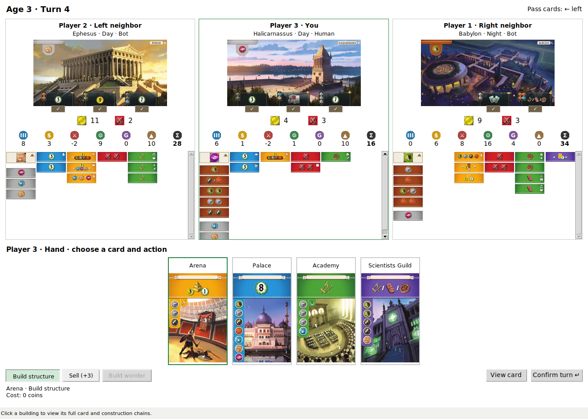

# Seven Wonders Engine

A standalone C++ simulation of **7 Wonders Second Edition (2020), base game**.
This project is a fork of [DMAG/UFSM's original simulator](https://github.com/dmag-ufsm/7Wonders).
Its main contribution is updating that simulator to the second edition's cards,
wonders and rules. It currently supports three players.

The engine is well suited to training reinforcement-learning models. Other
programs receive the game state and available actions as JSON, submit their
choices, and receive updated states and scores. The simulator runs as a separate
process, so agents can use any language or learning framework; a Python client
is included.

## Build

Requires CMake and a C++17 compiler. Linux/Ubuntu, including WSL, is supported.

```sh
cmake -S . -B build -DCMAKE_BUILD_TYPE=Release
cmake --build build --parallel 2
```

## Play with the graphical interface



The GUI requires Python 3.10+, Tk and Pillow. On Ubuntu, install Tk with
`sudo apt install python3-tk`. Then, from the repository root:

```sh
python3 -m venv .venv
source .venv/bin/activate
python -m pip install -e '.[gui]'
python Game.py 2 --seed 8
```

`2` starts one human against two simple bots. Use `0` for three local humans or
`3` to watch the bots. Select a card and action, then click **Confirm turn**.
Click a built building to see its full card and construction chains.

The card, wonder and resource artwork is included in [images/](images/) and
loads automatically. See the [GUI guide](docs/GUI.md) for controls and options.

## Connect an agent or another program

The engine exchanges JSON files in an isolated working directory for each game:

1. Read `io/game_status.json` for the current state, scores and offered actions.
2. Select an offered action and write it to `io/commands.json`, then signal it
   with `io/ready.json`.
3. Read the engine's acknowledgement and next state; repeat until the game ends.

The Python `DecisionClient` handles process startup, temporary directories and
file exchange:

```python
from sevenwonders_engine import DecisionClient

with DecisionClient("build/7Wonders", seed=8) as game:
    while game.state["game"]["phase"] != "finished":
        choices = {}
        for decision in game.state["decisions"]:
            option = next(o for o in decision["options"] if o["selectable"])
            choices[decision["actor"]] = option["option_id"]
        game.submit(choices)
        game.wait()
    print(game.state["result"]["totals"])
```

Replace the example's first-available choice with your agent's policy.
See the [protocol reference](docs/PROTOCOL.md) for the full message format and
[Seven Wonders RL](https://github.com/martenkrohn/seven-wonders-rl) for a training
project built on this engine. The C++ simulator itself needs no RL framework.

## Checks and implementation notes

```sh
ctest --test-dir build --output-on-failure
python3 scripts/smoke_protocol.py --engine build/7Wonders --seed 8
```

Details: [supported scope](docs/KNOWN_ISSUES.md),
[implementation changes](docs/SIMULATOR_CHANGES.md),
[source history](docs/ORIGIN.md) and [development guide](docs/DEVELOPMENT.md).

The simulator code is GPL-3.0-only; see [LICENSE](LICENSE) and [NOTICE](NOTICE).
The artwork retains its original rights and attribution; see [images/README.md](images/README.md).
