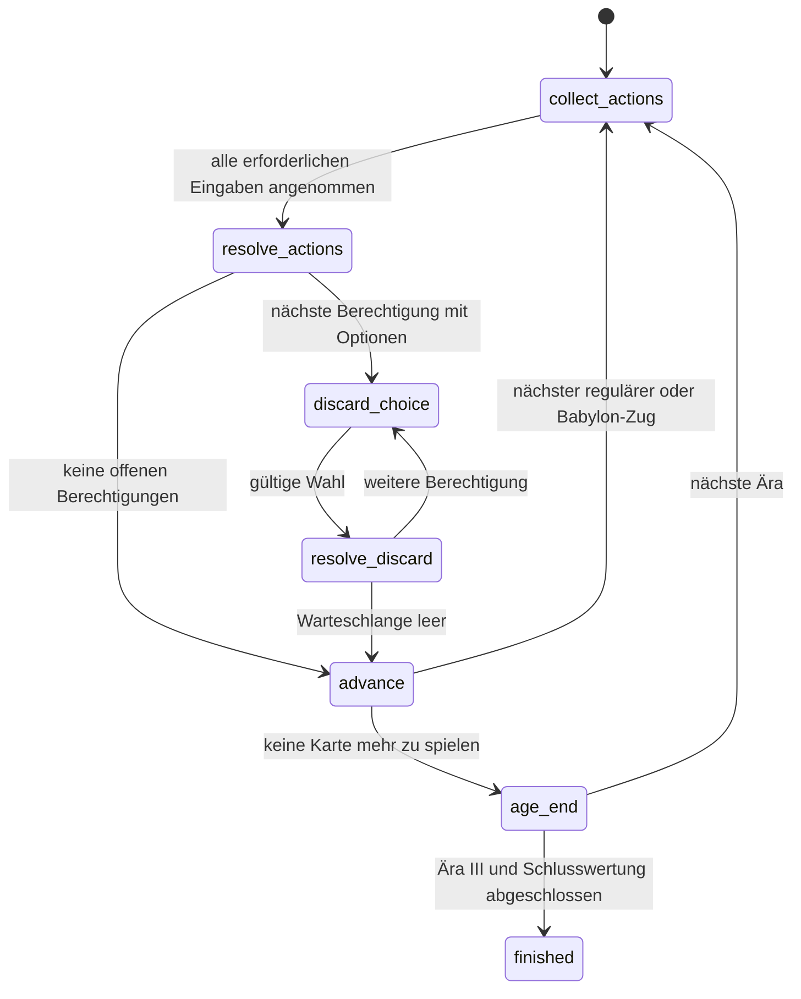

# Entscheidungs- und Auflösungsvertrag – Entwurf aus Paket 4a

Stand: 5. November 2026. Spezifikationsursprung aus Paket 4a:
**`decision-v1-draft`**. Paket 4b-II implementiert inzwischen den Vertrag als
**`decision-v1`**, Transportversion **3**; maßgeblich für den aktiven Transport
ist [PROTOCOL.md](PROTOCOL.md). Der [Entwicklungskontrakt](../engine-contract.json)
behält `second_edition_implemented=false`. Karten/Wunder folgen weiterhin den
bisherigen Definitionen. Aktive Fähigkeiten (insbesondere Legacy-Olympia) und
Nachweisgrenzen: [SIMULTANEOUS_RESOLUTION.md](SIMULTANEOUS_RESOLUTION.md).
Die historischen Beispielkennungen bleiben als Entwurf gekennzeichnet und
sind keine direkt zustellbaren Requests; die verbindlichen Feldnamen und
Fachentscheidungen liegen der Umsetzung zugrunde.

## 1. Geltung, Quellen und entschiedene Fachfragen

Ziel ist das BGA-Grundspiel mit drei Sitzen, ohne Erweiterungen. Maßgeblich sind
die [eingefrorenen Ziele](../data/bga-second-edition/README.md). Der Vertrag
erfindet keine Regeln aus BGA-IDs und enthält keinen BGA-Servercode.

| Kennung | Quelle und hier geprüfter Inhalt |
| --- | --- |
| BGA | `data/bga-second-edition/targets.json` und `reference/wonders.json`: eigenständige Effekte für Ablagebau, siebte Karte und Olympia-Freibaurechte |
| RULES | [Offizielles Regelheft](https://cdn.svc.asmodee.net/production-rprod/storage/downloads/games/7wonders/en/sev-en02-rules-1716388903zBEZx.pdf), gedruckte S. 4–7; lokale Datei mit SHA-256 `b65a797b0bf8ef586d0d6a7b2f74fbc04ad310cbd28a102ed90ba539f4ba6779`: gleichzeitige Aktionen, Restkarten, keine doppelten Gebäude, Ressourcen- und Zahlungsregeln |
| EFFECTS | [Offizielle Effektübersicht](https://cdn.svc.asmodee.net/production-rprod/storage/downloads/games/7wonders/en/sev-en02-effects-description-1716388911mLqDj.pdf), S. 1–2: gleichzeitige Nachbarkarten beim Münzeffekt, Ablagewahl am Zugende, Babylon als neuer Zug |
| FAQ | [Offizielle FAQ](https://www.rprod.com/en/7-wonders/faq), geprüft am 5. November 2026: Einnahmen erst im nächsten Zug verwenden; Olympia bezieht sich auf den ersten/sechsten regulären Zug; Ablagebau erlaubt keinen Wunderbau |
| CODE | `main.cpp::Loop/NextTurn/GiveWonders`, `src/player.cpp::BuildDiscardFree/BuildStructure`, `gui/session.py`; aktuelle Zustände und nachgewiesene Grenzen, kein Beleg für BGA-Regeln |
| USER | Verbindliche Nutzervorgabe vom 5. November 2026 nach Paket 4a: RQ-1 **nein**, RQ-2 **nein**. Projektregelentscheidung, kein zusätzlicher Nachweis aus BGA-Servercode. |

Technische Festlegungen dieses Entwurfs (Kennungen, Quittierungen, atomare
Änderungen, synthetische Reihenfolge) sind bewusste Entwurfsentscheidungen.
Die folgenden ursprünglich offenen Fachfragen sind durch USER entschieden:

| Frage | Verbindliche Entscheidung und Herkunft |
| --- | --- |
| **RQ-1**: Zählt ein regulär gebauter Vineyard/Bazar auch eine erst in der nachgelagerten Halikarnassos-Wahl errichtete Nachbarkarte desselben Zugs? | **Nein (USER).** Reguläre Soforteffekte werden nach allen regulären Konstruktionen und vor der Ablagewahl gezählt. Spätere Ablagekonstruktionen ändern deren Auszahlung nicht rückwirkend. EFFECTS/BGA begründeten die ursprüngliche Frage; die Nutzervorgabe legt den Projektvertrag fest. |
| **RQ-2**: Darf Halikarnassos bei mindestens einer legalen Option freiwillig verzichten? | **Nein (USER).** Bei mindestens einer legalen Option muss gewählt werden; `can_skip=false`, keine angebotene Skip-Option. Gibt es keine legale Option, schließt die Engine automatisch ohne Ersatzaktion. EFFECTS/BGA begründeten die ursprüngliche Frage; die Nutzervorgabe entscheidet sie. |

Beide Fachfragen sind für die Implementierung geschlossen. Der vollständige
Entscheidungsautomat, simultane Auflösung und passende Clients müssen dennoch
separat implementiert und abgenommen werden. Die Nutzervorgabe ist ausdrücklich
von einer unabhängigen Überprüfung des BGA-Servers getrennt.

## 2. Identitäten, Zustandsstand und Sichtbarkeit

| Feld | Bedeutung |
| --- | --- |
| `game_id` | Neue, opake Kennung je Prozesspartie; Seed ist keine Sitzungskennung |
| `revision` | Monotoner Veröffentlichungszähler; kann sich bei gleicher Runde ändern |
| `game.turn` | Spielzugslot: `(age-1)*7 + round_in_age-1`; 0–20, zum normalen Abschluss 21 |
| `game.round_in_age`, `round_kind` | 1–6 und `regular`, oder 7 und `seventh`; kein regulärer siebter Zug für alle Sitze |
| `game.resolution_id`, `game.snapshot_id` | Einmalige Auflösung und unveränderlicher Anfangszustand dieses Zugs |
| `decision_id` | Eine konkrete Eingabemöglichkeit eines bestimmten Sitzes in dieser Partie |
| `offered_revision` | Veröffentlichungsstand, zu dem diese Entscheidung angeboten wurde |
| `request_id` | Vom Koordinator erzeugte, innerhalb der Partie nie wiederverwendete Nachrichtenkennung |
| `card.instance_id` | Eine physische Kartenkopie, bei Deckaufbau vergeben und bei Ortswechsel beibehalten |
| `card.type_id`, `age`, `name` | Engine-Kartentyp, Ursprungszeitalter und Anzeige; Typ-ID, BGA-ID und Bildslot sind getrennt |
| `source_grant_id` | Einmalige Berechtigung aus genau einem erfolgreichen Stufenbau/Effektereignis |

Die `snapshot_id` einer regulären Entscheidung verweist auf den Rundenanfang;
eine Ablageentscheidung erhält einen eigenen unveränderlichen Stand nach
regulärer Auflösung bzw. vorherigen Ablagewahlen. Der Rundenanfang bleibt in
`game.snapshot_id` zu Prüfzwecken erhalten.

Zwei Kopien desselben Typs und die grauen Altersvarianten haben verschiedene
`instance_id`. Diese Kennung wird weder als Vektorindex interpretiert noch nach
einer Entnahme neu vergeben. Eine Karte befindet sich genau an einem Ort:
Deck, Hand, Stadt, verbaut unter Wunder oder Ablage. Unter einem Wunder
verbaute Karten gelangen nicht in die Ablage. Doppelte Gebäude werden nach
logischem Kartentyp ausgeschlossen, auch bei verschiedenen Instanzen/Zeitaltern.

Ein `snapshot_id` bleibt für alle regulären Eingaben dieses Zugs gleich. Die
Annahme der Eingabe eines anderen Sitzes macht übrige angebotene Entscheidungen
nicht veraltet. `revision` allein ist deshalb kein Ablehnungsgrund: Geprüft
wird die zur `decision_id` gehörende **`offered_revision`**.

Nachbarschaft ist je Sitz explizit: in den Beispielen links `(s+2)%3`, rechts
`(s+1)%3`. Handweitergabe in Ära I/III folgt `neighbors.left`, in Ära II
`neighbors.right`. Zahlungspläne verwenden konkrete Empfängersitze:
`payment={bank,to_seats:{"0":n,"1":n,"2":n}}`, alle Werte nichtnegative
ganze Münzbeträge, Selbstzahlung 0. Dies vermeidet Links-/Rechtsverwechslungen.

Der Dateikoordinator ist wie bisher vertrauenswürdig und koordiniert alle
Sitze. Er erhält den Gesamtstatus; das ist keine neue Zugriffsschutzgrenze.
An eine Policy/einen Sitz weitergereicht werden nur öffentliche Stadt-,
Wunder-, Ressourcen- und Punkteangaben sowie dessen eigene Hand/Entscheidung.
Noch nicht aufgelöste reguläre Wahlen bleiben verdeckt; veröffentlicht wird
allenfalls die Menge der bereits eingegangenen Sitze. Die Ablage hat öffentlich
nur einen Zähler. Ihr Karteninhalt erscheint ausschließlich in der aktuellen
Ablageentscheidung für deren berechtigten Sitz. Nicht gewählte Optionen dürfen
nicht in fremde Beobachtungen oder deren Verlauf kopiert werden.

## 3. Zustandsautomat und Abschlussbarrieren

| `game.phase` | Wer handelt / sichtbare Information | Erlaubter nächster Zustand |
| --- | --- | --- |
| `collect_actions` | Genau die Sitze aus `waiting_for`; eigene legale Optionen aus dem gemeinsamen Anfangszustand | Nach allen angenommenen Eingaben `resolve_actions`; Fehler bleiben hier |
| `resolve_actions` | Engine; keine Spieleingabe, gemeinsamer Aktionssatz wird atomar aufgelöst | `discard_choice`, `advance` oder Abbruch |
| `discard_choice` | Genau ein Sitz, aktuelle Ablageoptionen und dessen Quelle/Berechtigung | Erfolgreiche Wahl nach `resolve_discard`; ungültige Eingabe bleibt hier |
| `resolve_discard` | Engine; genau eine Karte/ein Effekt wird atomar angewandt | Nächste `discard_choice` oder `advance` |
| `advance` | Engine; keine Eingabe, keine ungeklärte Berechtigung | Nächste `collect_actions`, oder `age_end` |
| `age_end` | Engine; alle Zug- und Zusatzentscheidungen abgeschlossen | Kämpfe genau einmal; nächste Ära `collect_actions` oder Schlusswertung und `finished` |
| `finished` | Niemand; vollständige Kategorien, Gesamtpunkte, `scores_final=true` und `result` | Unveränderlicher normaler Endzustand |
| `aborted` | Niemand; Fehlergrund und letzter konsistenter Zustand, `scores_final=false`, `result=null` | Unveränderlicher Abbruch, keine Sieger-/Trainingswertung |

Ungültige Nachrichten führen nicht zu einem Zustandswechsel. Abbruch ist aus
jedem nicht abgeschlossenen Zustand möglich, während einer atomaren Änderung
erst an deren nächster konsistenter Grenze. Leere Auswahl überspringt die
Engine ohne künstliche Clientaktion. Interne Auflösungszustände dürfen als
Fortschritt veröffentlicht werden, verlangen aber keine Platzhalteraktionen.
Eine Veröffentlichung löst selbst niemals Effekte aus.
`waiting_for` enthält nur Sitze mit noch nicht angenommener Eingabe;
`decisions` enthält deren offene Angebote. Nach `accepted` verschwindet das
Angebot aus dieser Liste, bleibt intern für Prüfung und Wiederholung gesperrt
gespeichert. Die übrigen Angebote behalten ihre ursprüngliche Kennung und Revision.

## 4. Reguläre Auflösung: Produktion, Zahlungen und Effekte

1. **Anfangszustand festhalten.** Hände, Städte, Produktion, Rabatte, Münzen
   und Freibaurechte bestimmen alle legalen Optionen. Der Koordinator wählt
   angebotene Optionen; er erfindet keine Zahlungsbeträge. Mehrere passende
   Einkaufspläne werden je Handlungs-/Freibaumodus kanonisch ausgewählt: kleinste
   Gesamtausgabe, dann kleinste Zahlung an links, dann rechts, dann
   lexikografische Ressourcenbelegung nach Quelleninstanz und Ressource.
   Der Plan steht im Angebot. Ein kostenfreier Kettenbau verbraucht kein
   zusätzliches Freibaurecht. Dieser Vertrag erweitert nicht den Zahlungsaktionsraum.
2. **Eingaben sammeln und reservieren.** Genau eine Option je erforderlichem
   Sitz. Annahme heißt `accepted`, nicht schon ausgeführt. Kein Geld, keine
   Karte und keine Berechtigung wird vor der gemeinsamen Auflösung verändert.
   Nach Annahme ist diese Entscheidung gesperrt und nicht austauschbar.
3. **Alle Pläne gegen denselben Anfangszustand prüfen.** Bank-/Nachbarzahlungen
   jedes Käufers müssen aus seinen Anfangsmünzen gedeckt sein. Neue Einnahmen,
   neue Rabatte oder Produktion derselben Auflösung finanzieren keine Aktion.
   Auswahlproduktion wird je eigenständigem Käuferplan belegt, nicht global
   zwischen Sitzen verbraucht. Zwei Nachbarn dürfen dieselbe Produktion kaufen;
   ein Verkäufer behält sie auch für die eigene Aktion (RULES S. 7).
4. **Gemeinsam anwenden.** Handkarten entfernen und in Stadt/Wunder/Ablage
   verschieben, Zahlungen ausbuchen und Zahlungseingänge addieren. Kein früher
   bearbeiteter Sitz ändert die Legalität eines anderen. Bei unerwartetem
   internem Fehler kein teilweise angewandter Aktionssatz veröffentlichen:
   atomar zurückrollen und mit `resolution_error` abbrechen. Eine ungültige
   Eingabe wird zuvor abgelehnt; es gibt keinen stillen Ersatzabwurf.
5. **Zählzustand und Folgeeffekte.** Der gemeinsame Zustand nach sämtlichen
   regulären Konstruktionen liefert die Zähler regulärer Soforteffekte:
   passende Nachbarkarten derselben regulären Auflösung zählen mit; eine
   Lighthouse zählt sich selbst mit (EFFECTS). Einnahmen werden gespeichert,
   aber erst im nächsten Zug ausgebbar. Neue Ablage-/Zusatzzugrechte entstehen
   aus genau einem erfolgreich angewandten Quelleffekt. Spätere
   Ablagekonstruktionen ändern diese regulären Münzzähler nicht (RQ-1/USER).

Eine sortierte Schleife darf intern Änderungen übernehmen, aber nicht die
Zahlbarkeit oder Zähler mit einem bereits teilweise veränderten Zustand
neu entscheiden. Produktionsanforderungen und tatsächlich gewählte Mengen
sind je Aktionsplan nachvollziehbar zu halten.

## 5. Ablagewahl, Warteschlange und einmalige Entnahme

Ein erfolgreich errichteter Quellabschnitt erzeugt einen neuen Grant mit Sitz,
Quelle/Stufe, `resolution_id` und eindeutiger Ereigniskennung. Ein bereits
vorhandener Wunder-ID-/Stufenstand erzeugt beim erneuten Lesen keinen Grant.
Kein Grant wird in einer anderen Runde nachgeholt.

Die Warteschlange wird erst nach dem regulären Commit geöffnet. Enthalten
sind zuvor abgelegte Karten, aktuelle Verkäufe und fällige Restkarten ohne
Babylon-Recht. Eine für das Wunder verwendete Handkarte gehört nicht dazu.
Vor **jeder** Auswahl wird aus der dann tatsächlichen Ablage neu angeboten.
Alle Zeitalterkarten sind mit Instanz und Auswahlfähigkeit sichtbar; bereits in
der eigenen Stadt vorhandene Typen bleiben erkennbar, sind aber mit
`selectable=false, reason=duplicate_in_city` ausgeschlossen. Baukosten und
Ketten sind für den kostenlosen Gebäudebau irrelevant. Eine Ablagekarte darf
weder verkauft noch zum Wunderbau umgeleitet werden (FAQ).

Im regulären Grundspiel gibt es nur eine Halikarnassos-Familie; auch
`GiveWonders()` verhindert zwei Seiten derselben Familie in einer Partie.
Für technische Mehrfach-Grant-Prüfungen legt der Entwurf eine feste Reihenfolge
fest: Sitz 0, dann 1, dann 2; bei mehreren Grants desselben Sitzes Quellevent,
dann Effektindex aufsteigend. Das ist eine **technische Festlegung für
synthetische Zustände**, kein behaupteter BGA-Gleichstandentscheid. Erweiterungen
und zusätzliche Quellenfamilien sind nicht freigegeben; die offizielle
quellenübergreifende FAQ-Reihenfolge wird dadurch nicht ersetzt.

Eine Auswahl validiert Partei, Sitz, Entscheidung, Grant und angebotene Option
erneut. Der gleiche Instanzdatensatz muss noch in der zentralen Ablage liegen
und der Typ weiterhin neu für die Stadt sein. **Atomarer Erfolgsfall:** Karte
einmal aus der zentralen Ablage nehmen, Gebäudeeffekt einmal anwenden, einmal
zur Stadt hinzufügen, Grant als `consumed_build` schließen und final quittieren.
Keine Handposition wird gelesen oder gelöscht. Bei Fehler bleiben Karte, Hand,
Stadt, Geld und Grant unverändert; interne Fehler brechen kontrolliert ab.

Bei null legalen Optionen schließt die Engine den Grant automatisch als
`consumed_no_options`; die Ablage bleibt gleich. Es gibt weder Münzen noch eine
Ersatzaktion. Bei legalen Optionen ist freiwilliges `skip` im hier definierten
Grundspiel ausgeschlossen: `can_skip=false`, keine Skip-Option (RQ-2/USER).
Das allgemeine Hüllenfeld bleibt vorhanden, erweitert aber nicht diese Regel.
Ein ungültiges oder veraltetes Gesuch verbraucht nichts. Ein Abbruch markiert
offene Grants als `cancelled_abort`, nicht als verbaut oder für später verfügbar.

Nach einem kostenlosen Gebäudebau werden dessen unmittelbare Effekte auf dem
dann konsistenten Zustand ausgewertet; neue Produktion wird erst in einem
folgenden Zug benutzt. Weitere Grants würden hinten gemäß derselben festen
Ordnung eingereiht; im hier definierten Kartenbestand erzeugt eine solche
Karte keinen rekursiven Ablagebau. Vorherige reguläre Zähler werden unter der
Entscheidung aus RQ-1/USER nicht rückwirkend ausgezahlt.

## 6. Sechster Zug, siebte Karte und Ärenende

Nach den regulären Zügen 1–5 werden Hände erst weitergegeben, wenn sämtliche
Folgeentscheidungen geschlossen sind. Erst danach entsteht der nächste
Anfangszustand. Kartenausteilen und Handweitergabe gehören zu `advance`, nicht
zur Sammlung oder zur einzelnen Konstruktion.

Im sechsten regulären Zug wird die nicht gewählte Restkarte ohne Münzen
abgelegt (RULES S. 5). Ein in diesem Zug neu errichtetes Babylon-Recht kann
die eigene Restkarte für den Zusatzzug erhalten (FAQ). Deshalb entscheidet
die Engine nach dem gemeinsamen Stufen-Commit über **behalten oder ablegen**;
diese logische Klassifikation und alle regulären Ablagen werden sichtbar,
bevor die nachgelagerte Ablagewahl angeboten wird. Keine Resthand wird weitergereicht.

Erst nach sämtlichen Zusatzentscheidungen des sechsten Zugs entsteht bei
aktivem Recht ein eigener `collect_actions`-Zustand für `round_kind=seventh`.
Er besitzt einen frischen Anfangszustand: Einkommen und Produktion des sechsten
Zugs sind jetzt verfügbar. Nur berechtigte Sitze erhalten Handoptionen nach
den normalen Kosten-/Aktionsregeln. Andere Sitze senden nichts und erhalten
keine Platzhalterkarte oder künstliche Lernentscheidung. Ohne berechtigte
Sitze wird der siebte Slot vollständig übersprungen; `turn` kann von 5 nach
7 beziehungsweise 12 nach 14 springen. Clients warten auf Entscheidungen
und `revision`, nicht auf `turn+1`.

Auch ein Zusatzzug muss seine eigenen Folgeentscheidungen abwarten. Olympia-
Freibaurechte werden in angebotenen Optionen ausgewiesen, nicht über IDs
erraten: erster regulärer Zug bzw. sechster regulärer Zug; ein Babylon-Slot
ist keine neue Gelegenheit für Olympias sechste Karte (FAQ). Ein erst im
ersten Zug gebautes Recht finanziert nicht rückwirkend dessen Handaktion.

Sind regulärer Schlusszug, Restkarten, gegebenenfalls Babylon und alle Grants
erledigt, folgen militärische Konflikte genau einmal. Erst danach nächste Ära
mit frischen Händen oder nach Ära III sämtliche Endeffekte und Schlusswertung.
`finished`, `scores_final=true`, `result` und normale Ergebnisdatei sind vorher
verboten, insbesondere bei einer letzten Ablagewahl in Ära III.

## 7. Nachrichten, Quittierung, Wiederholung und Fehler

Die [maschinell lesbaren Beispiele und Abnahmefälle](decision-protocol-examples.json)
zeigen die verbindlichen Feldnamen. Die Statushülle enthält `protocol_version`,
`contract_id`, `game_id`, `revision`, `engine`, `game`, `waiting_for`,
`decisions`, `players`, `discard_count`, `receipts`, `events` und `result`.
Zusätzlich führt `grants` die Quellen/Besitzer und deren Lebenszyklus explizit;
`neighbors` steht bei jedem Sitz. Ein Grant enthält `grant_id`, `actor`,
`source={kind,wonder_id,stage,event_id}`, `resolution_id`, `status` und
`effect_event_id`. Zustände sind `pending`, `active`, `consumed_build`,
`consumed_no_options`, `consumed_skip` und `cancelled_abort`.
`engine` führt Release, konkreten Quellcommit, Regelnamen, Editionsstatus und
tatsächlich verfügbare `capabilities` getrennt. Fähigkeiten der Spieler stehen
zusätzlich als `available_abilities` im jeweiligen Spielerzustand. Fehlende
Fähigkeit heißt nicht verfügbar, unabhängig vom Wunderbild oder Typnamen.

Ein `players`-Eintrag enthält mindestens Ressourcen/Münzen, Wunder-ID/Stufe,
`hand_cards` und `built_cards` als Kartenreferenzen sowie verfügbare Fähigkeiten.
Weitere bestehende öffentliche Kategorien/Produktionsangaben bleiben Teil der
Beobachtung; der Entwurf legt keine neue RL-Merkmalsmatrix fest. Die hier
kleinen Beispiele illustrieren ausschließlich den Entscheidungsvertrag:
Produktionsfelder, nicht beteiligte Optionen und Zwischenzüge sind gekürzt.
Sie sind keine vollständigen spielbaren Zustandsfixtures. Ein Laufzeitangebot
muss sämtliche legalen Handlungs-/Freibaumodi des betreffenden Sitzes abbilden.

Eine Entscheidung enthält `decision_id`, `actor`, `kind` (`regular`, `seventh`
oder `discard`), `offered_revision`, `snapshot_id`, `source_grant_id` (sonst
`null`), `can_skip`, `timeout_ms` (sonst `null`) und `options`. Jede Option
enthält `option_id`, `kind`, `card`, `payment`, `free_source`, `selectable`
und `reason` (`null` bei erlaubter Auswahl). `kind` ist `build_structure`,
`build_wonder`, `discard`, `build_discard_free` oder `skip`. Eine Kartenreferenz
besteht aus `instance_id` (String), `type_id` (Integer), `age` (1–3) und `name`.
Nur die Skip-Option hat `card=null`. Zusätzliche Kosten-/Quellparameter in
einer Eingabe sind unzulässig; unbekannte Eingabefelder werden abgelehnt.

Eine Eingabe enthält dieselben `protocol_version`, `game_id`, ferner
`request_id`, `actor`, `decision_id`, die **angebotene** `offered_revision` und
`action={kind, option_id, card_instance_id}`. Die Option bindet Handlung,
Karteninstanz, kostenloses Recht und den festen Zahlungsplan; der Client darf
diese Bindung nicht überschreiben. Namen, Typ-IDs und Hand-/Ablageindizes
sind keine zulässige Kartenwahl.

Reguläre Eingaben werden zunächst mit `accepted` quittiert, nach gemeinsamer
Auflösung mit `applied`. Ablagewahlen werden atomar ausgeführt und direkt
`applied`. Receipts führen Eingabe-/Entscheidungskennung, Sitz, Status,
Fehlercode, Veröffentlichungsstand und gegebenenfalls `effect_event_id`.
Quittierungen werden im `receipts`-Feld von `game_status.json` veröffentlicht;
`receipt_fragment` in den Beispielen ist ein Auszug, kein zusätzlicher Dateikanal.
Automatische Erledigungen haben `request_id=null` und einen eigenen Event.
Ledger und Ereignisse bleiben für die Lebensdauer der Partie nachvollziehbar.
Erlaubte Receipt-Status sind `accepted`, `applied`, `rejected`, `skipped`,
`skipped_no_options` und `cancelled`; freiwilliges Skip schließt einen Grant
als `consumed_skip`. Ein Event nennt `event_id`, Typ, Sitz, Entscheidung und
gegebenenfalls Grant/Karte. Ein expliziter Abbruch ist eine Kontrollnachricht
`{protocol_version,game_id,request_id,control:"abort_game",reason}` ohne
vorgetäuschten Sitz oder Kartenentscheidung. Sie wird nur vom lokalen
Koordinator ausgelöst; ihr Receipt hat `actor=null` und `decision_id=null`.
Ein Abbruchgrund ist ein kurzer String. `finished.result` enthält die finalen
Punkte pro Sitz; Punkte vor `finished` sind vorläufig, `result` bleibt `null`.
Im normalen Endzustand sind `age=4`, `turn=21`, `round_in_age=null` und
`round_kind=null`; alle anderen Phasen behalten den zugehörigen aktuellen Zug.

Identische Wiederholung von `(game_id, request_id, vollständiger Inhalt)`
liefert den zuletzt gespeicherten Receipt zurück; `accepted` kann inzwischen
zu `applied` fortgeschritten sein. Sie führt nie erneut aus und erhöht weder
Revision noch Eventzähler. Dieselbe Kennung mit anderem Inhalt ergibt
`request_id_conflict`. Eine neue Kennung für eine gesperrte/geschlossene
Entscheidung ergibt `decision_locked`/`decision_closed`. Nach Ablehnung ist
zur Korrektur eine neue `request_id` nötig, derselbe offene Entscheidungsstand
bleibt gültig. Neue Revisionen durch andere Receipts invalidieren ihn nicht.
Die Konfliktantwort überschreibt niemals den gespeicherten Originalrequest
oder dessen Receipt. Nach Hüllen-/Versions-/Partieprüfung wird zuerst die
Requestkennung geprüft, danach Entscheidung/Sitz, Angebotsstand und Option.
So bleibt auch die Wiederholung nach einem abgeschlossenen Zug eindeutig.

Weitere Codes: `unsupported_protocol`, `wrong_game`, `wrong_actor`,
`unknown_decision`, `stale_offer`, `unknown_option`, `card_mismatch`,
`duplicate_in_city`, `card_unavailable`, `grant_unavailable` und
`malformed_request`. Ablehnungen sind **kein** erfolgreicher Spielschritt,
kein Rechtverbrauch und kein automatischer Abwurf. Ein interner Verstoß gegen
die angebotene Legalität ist ein Auflösungsfehler, keine strategische Niederlage.

## 8. Dateiaustausch, Timeout und Verbraucher

Der vorgeschlagene Transport bleibt dateibasiert: ein lokaler Koordinator,
ein isolierter Partienordner. Er schreibt `io/commands.json` atomar als
Bundle `{protocol_version:3,game_id,batch_id,requests:[...]}` und danach `io/ready.json` mit
derselben Version/Partie-/Bundlekennung. Die Engine liest einen konsistenten Bundle-
Stand, prüft die Kennungen und verarbeitet Requests; `game_status.json` wird
atomar veröffentlicht. Reguläre Requests dürfen gemeinsam eintreffen; während
einer Ablagewahl wird nur der aktive Sitz erwartet. Ein neues Bundle wartet
bis zur Quittierung des vorherigen. `ready.txt` und die drei alten Spielerdateien
werden unter Version 3 nicht zusätzlich interpretiert. Bundles ersetzen keine
Request-Deduplikation; Wiederzustellung benutzt dieselben Requestkennungen.
Eine `batch_id` wird ebenfalls nicht mit anderem Inhalt wiederverwendet;
abweichender Inhalt unter gleicher Kennung ist `batch_id_conflict` vor jeglicher
Annahme neuer Requests. Das Ledger bleibt an den Requestkennungen orientiert.

Eine abweichende Ready-/Bundlekennung wird nicht verarbeitet. Bei einem
unvollständig lesbaren Bundle wartet die Engine auf konsistente Zustellung
bis zum konfigurierten Deadline-/Abbruchpfad. Das Format ist keine sichere
Remote-Sitz-Authentisierung. Wiederaufnahme nach Prozessabsturz ist nicht
spezifiziert: neue Partie, neue `game_id`, keine alten Befehle wiederverwenden.

Eine Engine-Deadline je angebotener Entscheidung ist optional (`null` heißt
unbegrenzt). Sie wird durch falsche oder wiederholte Eingaben nicht verlängert.
`timeout_ms` läuft auf der monotonen Engine-Uhr ab der ersten Veröffentlichung
dieses Angebots. Für einen wartenden Grant läuft vor seinem eigenen Angebot
keine Entscheidungsfrist; für eine bereits angenommene Eingabe ist sie erfüllt.
Ablauf erzeugt `aborted` mit `decision_timeout`; ein expliziter Koordinator-
Abbruch erzeugt `aborted` mit angegebenem Grund. Bereits konsistent verbuchte
Züge werden nicht zurückgerollt, unaufgelöste reguläre Wahlen werden verworfen.
Bereits angenommene, noch nicht angewandte Requests erhalten `cancelled`;
offene Entscheidungen eine automatische Abbruchquittierung. Bereits `applied`
quittierte Aktionen behalten ihren Erfolg. Abgelehnte Nachrichten dürfen als
Receipts eine neue Revision erhalten, ändern aber keine Spielwelt.
Es gibt keine fingierte Schlusswertung. Ein bloßer Client-Lesetimeout ist
zunächst ein Transportproblem: nachfragen/weiterlesen oder explizit abbrechen,
keine neue Kartenwahl unter einer neuen Partiekennung vortäuschen.

GUI und RL müssen Statusrevisionen und `waiting_for` auswerten. Sonderwahl
benötigt eine eigene Darstellung/Aktionsdomäne; sie wird nicht in die 28
Handaktionen gepresst. Verlauf und Quittierung werden durch
`(game_id,decision_id,request_id)` adressiert, nicht durch einen einzigen Slot
pro `turn`. Der Collector erhält nur reale eigene Entscheidungen; ein
ordnungsgemäßes `finished` liefert Terminalreward, `aborted` entspricht
Abbruch mit ungültiger Transition, keiner Verlustwertung. Bei einer fremden
Zusatzwahl darf er warten, ohne eine eigene Lernaktion zu erzeugen.

`gui/session.py::poll/submit`, `SevenWondersEnv::_validate_status/_wait_status/
_send_action_impl/_wait_next_impl` und `ObservationHistory::observe/acknowledge`
erfüllen den neuen Vertrag heute ausdrücklich nicht. Ihre Anpassung gehört in
die jeweiligen späteren Pakete. Fähigkeiten werden erst beworben, wenn die
zugehörigen Engine-Pfade und Clients abgenommen sind.

## 9. Getrennte Implementierungsaufträge

**4b-I – sichere Ablageentnahme (abgeschlossen):** Zentrale physische Instanz, atomare Entnahme,
kostenlose Gebäudeanwendung ohne Handentnahme und korrekter Grantverbrauch;
Fehler-/Wiederholungsfälle direkt in C++ prüfen. Keine neue interaktive
Protokollfreigabe und keine Runden-/Zahlungsneufassung in diesem Auftrag.

**4b-II – Auflösung und Veröffentlichung (implementiert):** Gemeinsamer Anfangszustand,
Zahlungspläne, Münzeffekte gemäß RQ-1/USER, Warteschlange, Restkarten,
Babylon-/Ärenbarrieren, Nachrichtenledger und Protokollzustände. Erst mit
passenden Clients den interaktiven Ablagepfad gemäß RQ-2/USER freigeben.
Weitere Karten-/Wunderfähigkeiten, GUI und RL-Integration behalten ihre Pakete.
